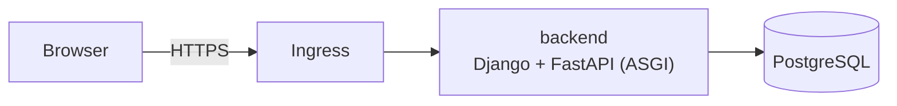

# Application structure

**Status**: Accepted

## Context

A new startup needs to put something in front of users quickly, run cheaply on
infrastructure its owner controls, and grow without a rewrite. These choices
are made once by the template so a project can start with its product, and are
recorded here so they can be revisited deliberately.

## Decision

1. **One repository** holds every service (`backend`, `e2e_tests`,
   `deployment`). A feature and its tests are one commit and one review. See ADR 0009.
2. **Django and FastAPI in one ASGI application.** Django provides the ORM,
   migrations, admin and server-rendered pages (with HTMX for interactions);
   FastAPI provides typed HTTP routes under `/api` and the OpenAPI schema.
   Routes and views stay thin; business logic lives in per-app `services.py`
   (ADR 0006).
3. **PostgreSQL** for all persistent data; schema changes go through Django
   migrations.
4. **Deployment** to the owner's Hetzner servers running k3s, provisioned and
   deployed by the startup CLI with shared Ansible roles.

## Consequences

- One service and one language to start with; a separate frontend can be added
  later as another service with its own `make.sh` (ADR 0005).
- The OpenAPI schema is available from the start, so a later frontend or mobile
  client can generate a typed client from it.

## Alternatives considered

- **Django alone with DRF:** a familiar stack, but FastAPI gives typed request
  and response models and the OpenAPI schema with less code.
- **A JavaScript frontend from day one:** use the Vue + Django template when the
  product needs a single-page application.
- **Managed platform (PaaS):** less operations work, but less owner control and
  higher cost as the startup grows.
